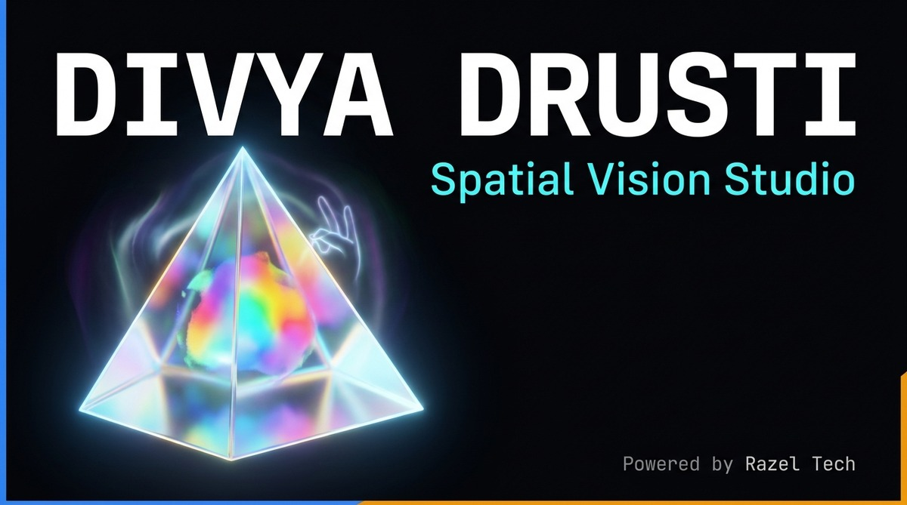

<div align="center">



# DIVYA DRUSTI — Spatial Vision Studio

**Real-time AR camera studio that runs entirely in your browser.**  
Shader effects, AI hair & makeup try-on, gesture spells, and a face-controlled game.  
No install. No server. Your video never leaves your device.

[](https://razeltech.github.io)
[](https://razeltech.github.io)
[](https://razeltech.github.io)
[](#credits)

</div>

---

## Table of Contents

1. [Overview](#overview)
2. [Feature Scenes](#feature-scenes)
3. [New in This Version](#new-in-this-version)
4. [Controls & Gestures](#controls--gestures)
5. [Studio Tools](#studio-tools)
6. [Run Locally](#run-locally)
7. [Deploy on GitHub Pages](#deploy-on-github-pages)
8. [Install as a PWA](#install-as-an-app-pwa)
9. [Add Your Own Quiz Questions](#add-your-own-quiz-questions)
10. [Ideas for Next](#ideas-for-next)
11. [Technology](#technology)
12. [Browser Support](#browser-support)
13. [Credits](#credits)

---

## Overview

**Divya Drusti** (दिव्य दृष्टि — "Divine Vision" in Sanskrit) is a single-file, zero-build-step browser application that turns your webcam into a real-time augmented reality studio. It is powered by Google MediaPipe for on-device AI tracking (hands, face, body pose, and multi-class segmentation) and a custom WebGL2 shader pipeline for visual effects.

Everything runs locally in the browser tab. No video is uploaded. No account is required. No native app install is needed — though it can be installed as a PWA for an offline-capable, full-screen experience.

**Powered by [Razel Tech](https://razeltech.github.io)**

---

## Feature Scenes

| Scene | What it does |
|---|---|
| **Spatial Prism** | Pinch both hands to open a floating window; shader effects apply only inside it. 14 shaders: **Spectral Prism** (hero optical glass refraction & Cauchy chromatic dispersion), **Prism Crisscross** (diamond facet lattice), **Kaleidoscope**, **Zoom Lens** (magnifies the area inside the prism), **Neon Edge**, **Gaussian Splat**, **Point Cloud**, **Depth Color** (AI person-aware depth map), **Glitch Prism**, **Cyber X-Ray**, **Matrix Grid**, **Thermal IR**, **Anime Cel**, **Film Negative C-41** |
| **Hair & Face AR** | AI hair segmentation + face-skin segmentation. Hair colour is blended in the shader while keeping real light and shine; skin smoothing, lipstick with gloss, cheek blush and bindi |
| **Mystic Jutsu** | Hand-tracked effects that scale with your hand (fist = small, open palm = big). Classic spells: Eldritch Shield (rotates with your wrist), Chidori Lightning, Rasengan Vortex, Sling Portal, Flow Ribbons. Interactive: Alchemy Circle, 3D Point Cloud, Finger Text, Light Painter, Flow Swarm (see below) |
| **Avatar** | Turns the camera into a motion-capture rig: the live feed is hidden and a 3D character copies your body in real time (see below) |
| **Prana Catch** | Catch orbs with your head or fingertip. **Arcade** mode (gold bonus, bombs, combo, levels, lives, mouth-open magnet, saved best) plus **learning modes**: Math Catch, World Capitals, Elements, Science Quiz |

**Studio tools:** photo capture (PNG with watermark), fullscreen, camera switch, mirror toggle, sound toggle, hand / pose / face-mesh skeleton overlays, and **PWA install**.

---

## New in This Version

### Mystic Jutsu: TouchDesigner-Style Interactive Effects

These follow the building blocks TouchDesigner artists use most: **feedback loops**, **particle emitters on tracked joints**, **flocking (attract / repel / follow)**, **flow-field noise** and **instanced point clouds**, all driven by your hands.

| Effect | How to drive it |
|---|---|
| **Alchemy Circle** | Transmutation circle with orbiting runes, counter-rotating triangles and a square. One hand: pinch wider = bigger, wrist roll rotates it. Two hands: it binds between your palms and its size follows their distance. Open palms to charge, **close fists to transmute** (golden burst). |
| **3D Point Cloud** | 1,600 live 3D points with perspective and depth colour. **Total fingers held up (0 to 10, both hands) pick the shape:** 1 sphere, 2 torus, 3 double helix, 4 cube, 5 spiral galaxy, 6 Lorenz attractor, 7 trefoil knot, 8 rippling wave sheet, 9 heart, 10 vortex tornado. Fist = small sphere. Hand tilt/roll rotate it, hand size or distance scales it, fingertips push points away. Shapes morph smoothly. |
| **Finger Text** | About 14,000 particles form **DIVYA** (large), **DRISHTI** (subtitle) and **SPATIAL VISION STUDIO** (caption) in three colours. **Push** them with any fingertip, **pinch** to pull them into a vortex, release and they spring back. Tap the tab again to type your own `Title | Subtitle | Caption`. |
| **Light Painter** | A real feedback loop: every frame is redrawn into itself, slightly zoomed, rotated and faded, so your fingertip strokes spiral outward into glowing rainbow trails. Pinch = fat brush, fist = clear. |
| **Flow Swarm** | 700 agents in a noise flow-field. They follow your index finger (pinch pulls tighter) and scatter away from a fist. |

The classic spells are sized from your hand and openness instead of filling the screen.

---

### Avatar: Your Body Drives a 3D Character (Live Feed Hidden)

Open the **Avatar** tab. The camera still runs for tracking but the video is hidden; only the character is shown, on a switchable backdrop (studio, neon grid, black, green screen).

**How the mapping works:**

1. **Auto-rig.** The bundled model (`avatar.glb`) is a static mesh with no bones, so DIVYA builds a 16-bone humanoid skeleton fitted to its measured joint positions (A-pose) and computes smooth skin weights for body, outfit and hair automatically.
2. **Skeleton retargeting.** MediaPipe Pose (33 landmarks, world coordinates) gives the direction of every limb; each bone is swung from its rest direction onto your limb direction. Torso and head orientation come from your shoulder, hip, ear and nose landmarks. Motion is smoothed, and limbs that leave the frame relax to the rest pose.
3. **Screen fit.** The rig's hips and shoulders are scaled and placed on your own hips and shoulders, so the avatar lines up with your body (turn on *Skeleton* to see the overlay match).
4. **Calibrate.** Press **Calibrate (3s)**, stand straight facing the camera, and your neutral posture becomes the avatar's neutral. *Reset Cal* clears it.

**Dock buttons:** Calibrate, Reset Cal, Backdrop, Skeleton overlay, Load GLB (try your own static GLB: it is scaled to the same humanoid proportions, so it works best for a standing A-pose character). Photo capture saves the avatar view.

**Limits:** fingers and face expressions are not animated (the model has no finger bones or blend shapes), and arm/leg twist is not captured. Best with your upper body in frame, good light and a plain background.

---

### Prana Catch: Learn While You Play

Pick a mode in the game dock. A question appears at the top and three answer orbs fall. Catch the right one with your head, nose or index finger. Wrong answers cost a life, you get instant feedback with the correct answer, and difficulty rises with level.

| Mode | Content |
|---|---|
| **Arcade** | Fast-paced reflex game with gold bonuses and hazards |
| **Math** | Arithmetic (+, -, ×, ÷), exponents, mental calculation scaling with level |
| **Physics** | Optics, mechanics, forces, wave frequencies, SI units |
| **Chemistry** | Elements, symbols, pH scales, chemical formulas, bonds |
| **Biology** | Cells, organ systems, genetics, anatomy, photosynthesis |
| **Astronomy** | Solar system, planets, light-travel times, cosmic distances |
| **World Capitals** | Global geography and nation capitals |
| **Custom Quiz** | In-app teacher modal to paste or load custom classroom questions |

---

## Controls & Gestures

1. **Dual pinch** (thumb + index on both hands) opens the spatial prism. Move fingers to reshape it, hands off-screen fades it.
2. Bottom tabs switch scene; the dock below changes effect, hair or lip colour, or spell.
3. **Capture Photo:** Tap the camera icon in HUD, press **Space** or **C**, or use Settings drawer → Snap. Optional gesture shutter (hold dual pinch 2s) can be enabled in Settings.
4. **Wink** to cycle through prism shader effects.
5. **Prism Crisscross** ripples and Kaleidoscope centre follow your index finger.
6. Settings (gear icon): effect sliders, skin smoothing, overlays, capture photo, install app.

---

## Studio Tools

| Tool | How to access |
|---|---|
| **Capture Photo** | Camera button in HUD, `Space`/`C` hotkeys, Settings drawer → Snap, or optional 2s Gesture Shutter |
| **Fullscreen** | Settings drawer → Go |
| **Mirror Toggle** | Top-right arrow icon |
| **Camera Switch** | Top-right camera icon (cycles between available devices) |
| **Sound Toggle** | Top-right speaker icon |
| **Install PWA** | Floating install banner at top or Settings drawer → Install |

---

## Educational Curriculum & Custom Teacher Packs

Educators and institutions can load custom quiz packs directly through the UI without editing code:
1. In **Prana Catch**, click **Custom Quiz**.
2. Select a STEM curriculum preset (Math, Physics, Chemistry, Biology, Astronomy, Capitals).
3. Or paste custom questions in CSV format:
   ```text
   Speed of light (km/s)?, 300,000, 30,000|3,000
   Powerhouse of the cell?, Mitochondria, Nucleus|Ribosome
   ```
4. Click **Load Custom Pack** to start an interactive classroom AR session.

---

## Run Locally

Camera access requires **HTTPS or localhost**.

```bash
npx serve .
# or
python3 -m http.server 8080
# Then open http://localhost:8080
```

---

## Deploy on GitHub Pages

1. Create a repository and push the modular structure (`index.html`, `manifest.json`, `sw.js`, `README.md`, `.gitignore`, and the `css/`, `js/`, `assets/`, `icons/` folders).
   The `manifest.json` and `sw.js` reference `icons/...`, and `app.js` loads `./assets/avatar.glb`.

2. Go to **Settings → Pages → Deploy from a branch → `main` / root**.

3. Open `https://<user>.github.io/<repo>/` and allow camera access.

> To publish at `razeltech.github.io` itself, name the repository `razeltech.github.io`.

---

## Install as an App (PWA)

- **Android / Chrome / Edge:** Settings → *Install App*, or tap the browser install icon in the address bar.
- **iOS Safari:** Share → *Add to Home Screen*.
- After the first online load, the app shell and MediaPipe models are cached and work offline. When you change files, bump `VERSION` in `sw.js` to force a cache refresh.

---

## Ideas for Next

GPU particle fluid simulation, audio-reactive visuals from the microphone, optical-flow feedback, finger and face animation for the avatar, VRM model support, more quiz packs, and a two-player collaborative game.

---

## Technology

| Layer | Technology |
|---|---|
| Shader pipeline | WebGL2 fragment shaders (14 custom effects) |
| 2D overlays | Canvas 2D API |
| 3D avatar | [Three.js](https://threejs.org) (loaded on demand) |
| Audio | Web Audio API |
| AI tracking | [MediaPipe Tasks Vision](https://developers.google.com/mediapipe) — hands, face, pose, multiclass segmentation |
| Architecture | Modular web app (`index.html`, `css/app.css`, `js/app.js`, `assets/`, `icons/`), zero build step |

---

## Browser Support

Latest Chrome, Edge, Safari 16+ and Firefox with WebGL2 and a camera enabled. Best performance on a device with a dedicated GPU.

---

## SEO & Social Sharing

This project ships with full Open Graph and Twitter Card meta tags so that sharing the GitHub Pages URL on **WhatsApp, Facebook, Twitter/X, LinkedIn, iMessage** and other platforms shows a rich preview card with the branded image, title and description.

The `og-preview.jpg` file (1200 x 675 px) must be deployed alongside `index.html` and served over HTTPS for platforms to fetch it.

---

## Credits

Built by **[Razel Tech](https://razeltech.github.io)**.
MediaPipe models (c) Google, Apache-2.0.

**Avatar model:** `avatar.glb` is the "Pandora Miwa" fan art model supplied by the project author. Check its licence on the original source before publishing a public deployment.
